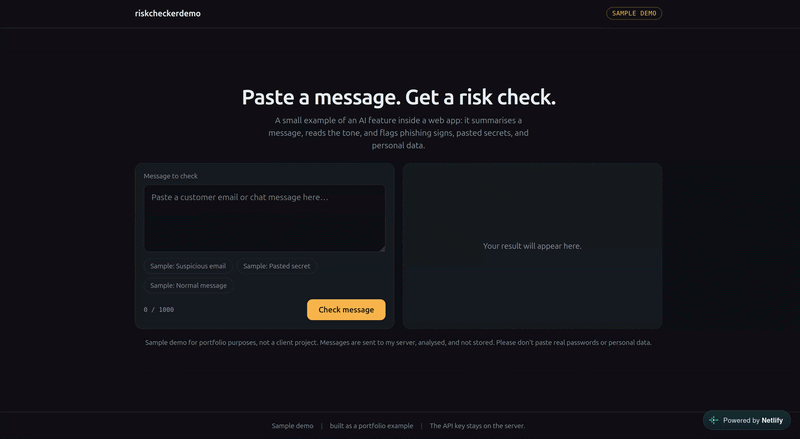

# riskcheckerdemo

Sample demo of an AI feature inside a web app: paste a message and get a short summary, the tone, and risk flags for phishing signs, pasted secrets and personal data.

> **Sample demo.** Built as a portfolio example, not a client project. Please don't paste real passwords or personal data.

**Live demo:** https://riskcheckerdemo.netlify.app



## Features
- Summary, tone and risk flags for any pasted message
- Sample messages (suspicious email, pasted secret, normal message) to try instantly
- The API key stays on the server and is never exposed in the browser
- Input limit of 1,000 characters
- Free-tries limit per visitor (5)
- Friendly error messages when the AI service fails or the limit is reached

## How it works
1. The browser sends the message to a Netlify Function.
2. The function adds the prompt and calls the Google Gemini API with the key stored in an environment variable.
3. The structured result comes back and is shown in the interface.

Messages are analysed and not stored.

## Tech stack
JavaScript, Netlify Functions, Google Gemini API (free tier), deployed on Netlify.

## Run locally
```bash
git clone https://github.com/sra1st/riskcheckerdemo.git
cd riskcheckerdemo
npm install -g netlify-cli
```
Create a `.env` file with your own key:
```
LLM_API_KEY=your_key_here
```
Then run:
```bash
netlify dev
```
[Confirm these steps work for your setup.]

## Limitations
LLMs can make mistakes, so results are a helpful signal, not a guarantee.

## Author
adi
